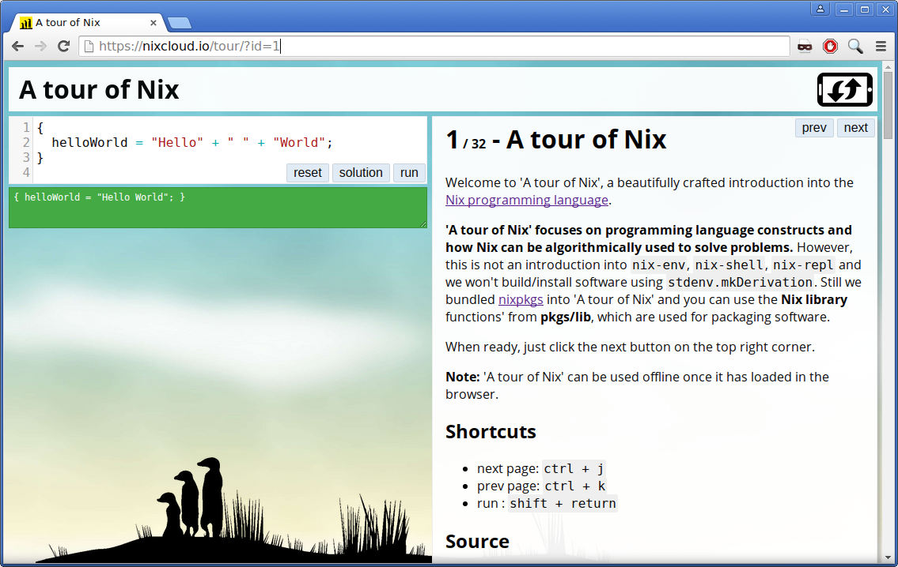

# introduction

this repository contains 'a tour of nix', an interactive programming guide dedicated to the 
nix programming language.

https://nixcloud.io/tour/ 

happy learning!

# building & running

the tour runs a real, current nix in the browser: [unkernel](https://github.com/pithings/unkernel),
a linux kernel compiled to webassembly, runs the aarch64 `nix-instantiate` from nixpkgs off a
read-only disk image. the pieces are pinned like in [trynix](https://github.com/fzakaria/trynix).
`vm/README.md` has the details.

    nix build                      # the static site in ./result
    nix run .#serve                # serve it on http://127.0.0.1:8137/

`result/` is a plain static site, any web server will do, for example:

    python3 -m http.server -d result

**note:** opening `index.html` from `file://` does not work; it needs a web server. the browser
needs JSPI (webassembly's javascript promise integration): chrome 137, firefox 153 or safari 27.

the build also evaluates every solution in `questions.json` with nix and fails if one does not
evaluate (`nix build .#expected`).

the 2014 version used nix 1.9 compiled with emscripten (nix-instantiate.js): 

  https://lastlog.de/blog/tour_of_nix.html

# collaboration

if you want to contribute questions or fixes to them, there is a file called `questions.json`. 
just edit this file, run `nix build` and reload the 'tour' in your browser. there is a guide on how to edit questions
contained in the last question of the tour https://nixcloud.io/tour/?id=end

    ctrl+, - loads markdown into the editor
    ctrl+. - compiles markdown2html into the right side
    ctrl+s - save the questions to questions.json into you downloads directory
    
**note:** this workflow is a big buggy, copy your questions also to a text editor as backup.

# future work

## source code rework

thanks to https://github.com/tomberek we have this now:

https://github.com/nixcloud/tour_of_nix/issues/22

# license

the questions.json file is licensed as:

       GNU LESSER GENERAL PUBLIC LICENSE
           Version 2.1, February 1999

exactly as the original nix codebase.

## third party

we bundled many different tools:

see `COPYING.md` for details on their license.

oh, and there is this font/ - directory. really don't have a clue what license that uses. was from google 
and is probably licensed 'world domination with no privacy' or something... not sure...

## nix in the browser

nothing of it is in this repository: `nix build` fetches it, pinned by hash in `flake.nix` and
`flake.lock`:

* nix and its runtime closure (aarch64-linux, from cache.nixos.org): LGPL-2.1 and the licenses of
  its dependencies
* the library of nixpkgs (`lib`): MIT
* [unkernel](https://github.com/pithings/unkernel): MIT and GPL-2.0-only (the kernel)
* [ghostty-web](https://github.com/coder/ghostty-web): MIT

the built site carries their license files next to them (`vm/vendor/`).

# authors

* Paul Seitz <paul.m.seitz@gmail.com>
* Joachim Schiele <js@lastlog.de>

